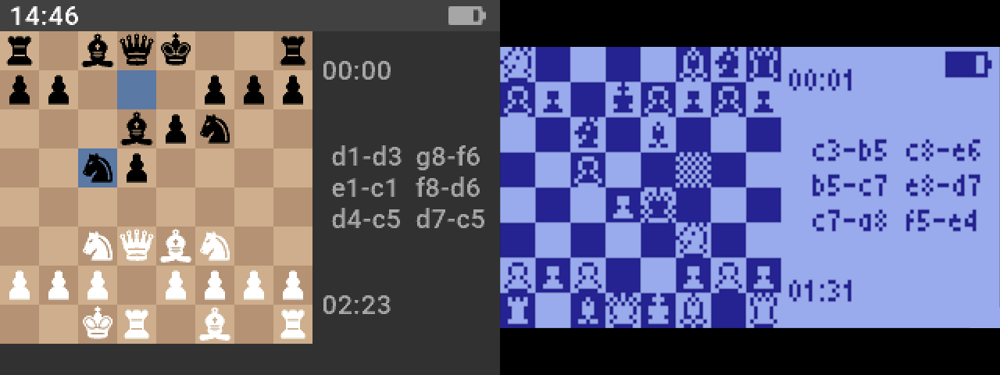

## Overview

mcu-max is an MCU-optimized C chess engine based on [micro-Max][micro-max-link]. It comes with an Arduino serial port example and a UCI example for use with chess GUIs.

Try it in the [Rad Pro simulator](https://gissio.github.io/radpro-simulator/) (click the right button and select Game at the bottom of the menu).

## Features

* About 2.1 kB of flash and 190 bytes of RAM (Cortex-M0, `-Os`).
* Legal move listing; check, checkmate and stalemate detection.
* Strength set by a node limit; stack usage bounded by a depth limit.
* Search can be stopped from a callback.
* Optional hash table; FEN input and output for testing.
* C99; the header also works from C++11.

## Usage

```c
#include "mcu-max.h"

mcumax_init();

// Player move: e2e4 (returns false if illegal)
mcumax_play_move((mcumax_move){MCUMAX_SQUARE(4, 1), MCUMAX_SQUARE(4, 3)});

// Engine move
mcumax_move move = mcumax_search_best_move(10000, 20);
mcumax_play_move(move);

if (mcumax_get_game_state() >= MCUMAX_GAME_STALEMATE)
{
    // Game over (stalemate or checkmate)
}
```

Squares are built with `MCUMAX_SQUARE(file, rank)` (0-7 each: files a-h, ranks 1-8) and read with `MCUMAX_SQUARE_FILE()` and `MCUMAX_SQUARE_RANK()`. Pieces are a type (`MCUMAX_PAWN`, `KNIGHT`, `BISHOP`, `ROOK`, `QUEEN`, `KING`) combined with a color (`MCUMAX_WHITE`, `MCUMAX_BLACK`), or `MCUMAX_EMPTY`; split them with `MCUMAX_PIECE_TYPE()` and `MCUMAX_PIECE_COLOR()`.

| Function | Description |
| --- | --- |
| `mcumax_init()` | Resets to the starting position. |
| `mcumax_get_piece(square)` | Returns the piece at a square. |
| `mcumax_get_current_side()` | Returns the side to move. |
| `mcumax_search_valid_moves(buffer, size)` | Lists the legal moves in board order; returns their number (which may exceed `size`). |
| `mcumax_get_game_state()` | Returns `MCUMAX_GAME_ONGOING`, `_CHECK`, `_STALEMATE` or `_CHECKMATE`. |
| `mcumax_search_best_move(node_max, depth_max)` | Returns the best move, without playing it. `depth_max` is at most 90. |
| `mcumax_play_move(move)` | Plays a move if legal; returns `true` if played. |
| `mcumax_set_callback(callback, userdata)` | Sets a callback, called at every search node (e.g. to feed a watchdog). |
| `mcumax_stop_search()` | Stops the search, from the callback; the search then returns `MCUMAX_MOVE_INVALID`. |
| `mcumax_set_fen_position(fen)`, `mcumax_get_fen_position(buffer)` | FEN input and output, for testing (`buffer`: `MCUMAX_FEN_SIZE` characters). |

Valid moves, game state and playing a move each run a short search: call them once per move.

## Configuration

Set these as compiler flags (e.g. `-DMCUMAX_HASHING_ENABLED`), or uncomment them at the top of `src/mcu-max.c` (e.g. for the Arduino IDE):

| Define | Effect |
| --- | --- |
| `MCUMAX_HASHING_ENABLED` | Enables the hash table. Requires `MCUMAX_HASH_TABLE_SIZE`. |
| `MCUMAX_HASH_TABLE_SIZE` | Hash table entries: a power of 2, 12 bytes of RAM each. |
| `MCUMAX_PAWN_EVAL_DISABLED` | Removes the pawn structure evaluation: about 100 bytes smaller, about 10-40 Elo weaker. |

The hash table lets the engine avoid repetitions, which it needs to win won endgames: at 4096-16384 nodes per move, a 1024-entry table (12 kB) raised king and queen (or rook) against king wins from under 25% to about 90%; 256 entries were not enough. Hashing also costs about 0.5 kB of flash and 1 kB of RAM.

## Memory usage

* **Flash:** about 2.1 kB, plus 0.7 kB if the FEN functions are used. Compile with `-ffunction-sections` and link with `--gc-sections` (the Arduino and PlatformIO default) to leave out unused functions.
* **RAM:** about 190 bytes, plus the hash table if enabled.
* **Stack:** `mcumax_search_best_move()` recurses at most `depth_max + 2` levels, of about 144 bytes each on Cortex-M (176 with hashing): about 2.6 kB for `depth_max` = 16. Other functions recurse at most 2 levels.

## Limitations

* Pawns always promote to a queen.
* Draws by repetition, the 50-move rule and insufficient material are not reported.
* There is a single, global engine instance.

## Testing

```sh
python3 -m pip install chess
cd tests
make test     # strict builds, API tests with sanitizers, legal moves, game
              # state and FEN against python-chess, regression test
make size     # linked code size on Cortex-M0 (needs arm-none-eabi-gcc)
make endgame  # wins of won endgames against Stockfish
```

Changes that intentionally alter the search must regenerate the regression test's `tests/regression.txt` (`python3 regression.py build/harness --update`). `tests/strength.py` plays matches between UCI engines and estimates Elo differences.

## Release notes

### 2.0.0

* Fixed legal moves: some were missing from `mcumax_search_valid_moves()`, castling out of or through check was allowed, and pawns set up by FEN could not advance two squares.
* Fixed hashing: repetitions and transpositions were not recognized, and small tables could confuse the side to move.
* Fixed the UCI example: promotions lacked the piece letter.
* New API: square macros, a single pawn piece type, `mcumax_get_game_state()` and `mcumax_get_fen_position()`.
* `depth_max` now bounds the stack usage.
* New option: `MCUMAX_PAWN_EVAL_DISABLED`.
* Code size about the same as 1.0.7.
* Test suite and continuous integration.
* Developed with the assistance of [Claude Code](https://claude.com/claude-code), Anthropic's AI coding tool.

### Migrating from 1.x

* Piece types were renumbered; `MCUMAX_PAWN_UPSTREAM`/`DOWNSTREAM` are now `MCUMAX_PAWN`. Empty squares return `MCUMAX_EMPTY` (previously `MCUMAX_EMPTY | MCUMAX_BLACK`).
* `mcumax_get_current_side()` returns `MCUMAX_WHITE` or `MCUMAX_BLACK`.
* `depth_max` limits the recursion depth; values above 90 are treated as 90.
* Hashing requires `MCUMAX_HASH_TABLE_SIZE`.

## License

MIT.

[micro-max-link]: https://home.hccnet.nl/h.g.muller/max-src2.html
